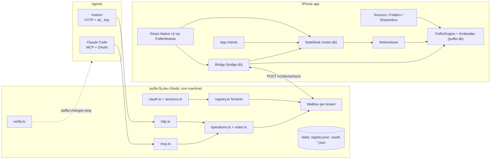
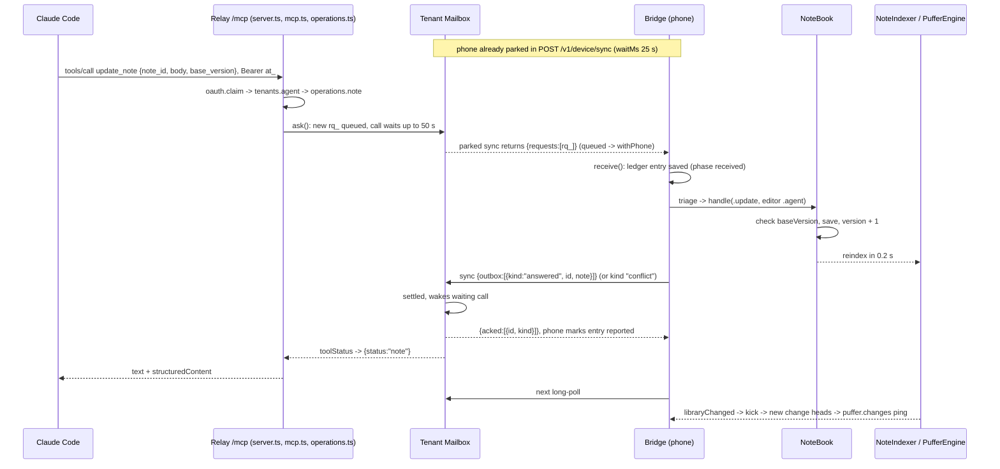

# Puffer architecture (after the notes pivot)

## Overview

Puffer is an iPhone notes app that agents can read and write. Everything lives on the phone in three SQLite files: `notes.db` (the notes, owned by the `NoteBook` actor), `puffer.db` (a hybrid vector and keyword index over notes and user-granted document folders, owned by `PufferEngine`, with vectors from EmbeddingGemma 2 running on the device through LiteRT-LM), and `bridge.db` (the request ledger, the list of connected agents and History's change reads, owned by `Bridge`). The phone is the only authority on which agents exist.

The relay at https://puffer.fly.dev (one Fly machine in fra, 256 MB, volume at `/data`) holds no content. It is a mailbox with one tenant per registered phone, each with its own in-memory `Mailbox`. An agent calls an MCP tool (`/mcp`) or the HTTP API (`/v1/...`); the relay queues the request and holds the agent's call open; the phone, long-polling `POST /v1/device/sync`, picks it up, runs it locally and returns the outcome on its next sync, which wakes the waiting call. If Puffer is not running, the agent gets a `request_id` to collect later.

## Key concepts

- **Tenant**: one registered phone. Its `dk_` device key lives in the phone's Keychain; the relay stores only the digest in `registry.json`. `Tenants` (registry.ts) maps device digests and agent key digests to tenants and evicts idle tenants from memory after 48 h.
- **Agent**: a connected client, known on both sides by a key digest. It authenticates either with an `ak_` key (connect by message) or an OAuth session (`at_` access token, 1 h; rotating `rt_` refresh token, 90-day sliding). `oauth.claim()` resolves either to a tenant and an agent.
- **Registry**: the phone's agent list with a revision number, pushed during sync. The relay refuses any agent not on it.
- **Request kinds**: `ask`, `recent`, `sources`, `changes`, and eight note kinds (`searchNotes`, `listNotes`, `listNoteFolders`, `getNote`, `createNote`, `appendToNote`, `updateNote`, `deleteNote`). On the relay: `queued` -> `withPhone` -> `settled`.
- **Ledger**: the phone's record of every request (the newest 500 settled and acknowledged entries are kept). There is no per-request consent: an agent is approved once, when it connects, and every request from a connected agent is answered at once. The outbox is not a table; it is the ledger entries whose phase the relay has not acknowledged.
- **Note**: Markdown body (first non-empty line = title; a first line set to Body is stored after one leading empty line, which the parser removes, so there is no implicit title), `version` (+1 per body change), `lastEditor` (user or a named agent), soft delete into Recently Deleted for 30 days, `origin` for import dedupe. Purging a note also removes `Documents/NoteAttachments/<id>`, and `NoteBook.open()` sweeps attachment folders whose note no longer exists.
- **Passage**: an indexed chunk. A note becomes passages `note:<id>#<version>:<n>`, so every new version is a fresh set of passages.

## How it works

### Components

### Phone data and search

`NoteBook` (Notes.swift) is the only writer of `notes.db`. `open()` loads every note and folder into memory, purges notes deleted more than 30 days ago, and runs the one-time `LegacyNotes` migration. Notes are written from three places: the editor (`src/ui/editor/NoteEditor.tsx` picks it with `EXPO_PUBLIC_PUFFER_EDITOR`: by default the native view in `modules/puffer-native/ios/Editor/` and its `NoteSession`, which loads, saves conflict-safely and closes in Swift; `tiptap` selects Tiptap in an Expo DOM component, `src/ui/editor/TiptapNoteView.tsx`, whose `NoteSaver` saves 600 ms after typing stops through `noteEditor.save` with the version it last loaded as base and on a conflict merges with native `NoteMerge`; `enriched` is picked in the note route `src/app/(tabs)/notes/note/[id].tsx`, which opens the react-native-enriched-html spike in `src/app/(tabs)/notes/enriched/[id].tsx`), agent requests (`NoteBook.handle` in NoteRequests.swift), and imports. Every write posts `Changes(.notes)` (so `NotesProvider` in src/notes.tsx reloads a body-less snapshot) and schedules `NoteIndexer`.

`NoteIndexer` debounces (2 s after a user edit, 0.2 s after an agent edit) and runs one reconcile at a time: it re-embeds every live note whose current version has no passages yet, removes deleted notes from the index, and calls `Bridge.libraryChanged()`. It does nothing until the embedding model is ready.

`PufferEngine` keeps `puffer.db` (items with vectors and metadata, plus one change event per write) and two in-memory indexes, `VectorIndex` (N x 768 Float32) and `Bm25`. `search()` takes 50 candidates, scores cosine + 0.1 x normalized BM25, drops anything below 0.68 raw similarity, and keeps hits within 0.1 of the best. The `Embedder` actor wraps LiteRT-LM (GPU first, then CPU) and lets queries jump ahead of indexing. While the app is in the background and the model runs on the GPU, indexing waits (`Embedder.untilForegroundOnGPU`, checked between batches); queries still run.

Document folders come in through `Sources.catchUp()` (single flight). `Folders.swift` keeps security-scoped bookmarks, scans up to 20k files and extracts PDF text with PDFKit. `ShareInbox` (Folders.swift) turns shared Markdown into notes and puts other shared files in "Shared with Puffer". Shortcuts imports (`AddToPufferIntent`, titled "Add to Puffer", and `SyncNotesIntent`, "Sync Notes to Puffer", in app-target/PufferIntents.swift; both accept files, text and rich text) go through `ShortcutImport.run` (ShortcutImport.swift: plain, HTML, RTF and RTFD to Markdown, skipping what cannot be read) and `NoteBook.importNotes` (the `NoteImport` helpers in Notes.swift): one transaction, dedupe on `source|title|created`, updates only notes the user has not edited since import, default folder "Imported".

### The relay

`server.ts` is a plain `node:http` router with body limits, deadlines, a Host/Origin guard and a 30 s sweep. Agents use MCP (`/mcp`, mcp.ts: a fresh stateless `McpServer` per request with 5 library tools, 8 note tools and `events/*`) or HTTP (http.ts: the same operations as REST, OpenAPI 3.1 at `/openapi.json`, agent instructions at `GET /start`). Both call `operations.ts`; the table `NOTE_OPERATIONS` in notes.ts generates the note tools, routes and OpenAPI entries. `protocol.ts` holds the zod wire schemas; `Relay.swift` mirrors them.

`Mailbox.ask()` attaches to an identical open query from the same agent within 10 min, enforces per-agent limits (10 open, 20 new per minute, 4 waiting calls) and waits until the request settles, the budget runs out (50 s MCP, 25 s default HTTP), or the phone has been offline for 2 s. `toolStatus()` is the single place that maps request state and presence to what the agent sees. Requests expire after 24 h. On the phone side, `Mailbox.sync()` applies outcomes first (first final outcome wins; unknown ids are still acknowledged), parks until a request is queued or `waitMs` passes, and hands over every `queued` or `withPhone` request. A newer sync returns the parked one empty.

### One agent request

### The Bridge loop

On foreground, `Bridge.start()` runs `ensureRegistered()` (one `POST /v1/device/register` with the signed-in account's session token as `Authorization: Bearer`, handed over by the JS Better Auth client through `setRelaySession`; nothing without a session; new installs default to puffer.fly.dev), then `restartLoop()`: one quick sync, then repeated 25 s long-polls with 1-30 s backoff when the relay is unreachable. Each `sync()` sends the outbox (up to 100 outcomes, about 40 MB), the registry if newer, change heads and per-agent change pages (up to 24 KB each) and declined connections; then applies acknowledgements, read cursors, the registry revision and `revokedKeys`; saves new requests to the ledger before handling them; and repeats while it has something to send. `kick()` starts a second sync immediately, which preempts the parked long-poll.

`triage()` routes by kind: note requests go to `NoteBook.handle` (`create` derives the note id from the request id so a retry does not duplicate; `update` returns `conflict` on a stale `baseVersion`; `delete` is soft); `ask` and `recent` search notes and documents together (notes go out as passages in folder `Notes/<folder>`), and `Triage.answer`/`Egress.materialize` build excerpts, whole texts or files; `changes` and `sources` are answered from the engine. Failures retry after 2, 10 and 30 s, then settle as failed. In the background the loop keeps polling for about 25 s before suspension; then `BGAppRefresh` runs one bounded sync (iOS decides when, at most every 15 min) and `BGProcessing` indexes while charging.

### Connecting an agent

Both paths end at the approve link `/c/<secret>`, which redirects to `puffer://connect/<id>?link=<secret>`. The connect modal (`src/app/connect/[id].tsx`) fetches `GET /v1/device/connects/by-link/<secret>` (claiming it for this phone's tenant), Approve posts `/confirm`, `Bridge.register` adds the agent's key digest and kicks a sync that pushes the registry, and `oauth.approve()` approves once the digest is in that tenant's registry.

- **OAuth** (Claude Code via `claude mcp add --transport http puffer https://puffer.fly.dev/mcp`): discovery, DCR or client metadata document, PKCE S256; the `/authorize` page shows the approve link as a QR and an "Open in Puffer" link and polls; after approval it redirects with a code and `/token` issues `at_` + `rt_`.
- **Connect by message** (Instinct and other HTTP agents): the agent reads `/start`, posts `/v1/connect` (optional signed `callback_url`), sends the user the approve link, and collects its `ak_` key once from `POST /v1/connect/<id>/token`.

Disconnecting on the phone pushes the registry and the relay revokes the agent. An approval nobody redeems becomes `abandoned`, appears in `revokedKeys`, and the phone removes the agent.

## Where things live

- `modules/puffer-native/ios/`: `Notes.swift` (Note, NoteBook, NoteIndex, NoteIndexer, LegacyNotes, NoteImport), `NoteRequests.swift`, `PufferEngine.swift` (engine, VectorIndex, Ranking, Bm25, Embedder), `ShortcutImport.swift`, `Puffer.swift` (public ids and report types, the Shortcut entry point), `Sources.swift`, `Folders.swift`, `Storage.swift`, `Bridge.swift`, `Relay.swift`, `Triage.swift`, `PufferModule.swift` (the JS boundary), `SystemHooks.swift` (background tasks, notifications, Spotlight, opened files), `Metadata.swift` (item metadata), `SwipeActions.swift` (a SwiftUI swipe-actions modifier for @expo/ui).
- `src/ui/editor/`: `NoteEditor.tsx` (chooses the editor) and the Tiptap note editor. `markdown.ts` (the Markdown codec, a port of `NoteMarkdown` checked byte for byte against it by `scripts/editor-markdown-check/run.sh`), `TiptapEditor.tsx` (the `'use dom'` component), `extensions/` (schema, attachment, note link, hashtag, foldable heading), `commands.ts`, `editor.css`, `TiptapNoteView.tsx` + `EditorToolbars.tsx` + `session.ts` (the native host: keyboard bar, Aa panel, saving). The enriched spike lives in `src/app/(tabs)/notes/enriched/`.
- `modules/puffer-native/ios/Editor/`: the native note editor, and what the Tiptap editor reuses from it (`NoteMerge`, attachments, `NoteExport`, `NotePaper`, the note-link sheet) through `NoteEditorModule`. `NoteDocument.swift` (document model, `NoteMarkdown` parser and serializer, `NoteMerge`; Foundation only), `NoteRendering.swift` (attribute keys, theme, styler, document <-> attributed string), `NoteLayout.swift` (TextKit 2 fragment that draws list marks, checkboxes, quote bars, table rules), `NoteTextView.swift` (UITextView editing behavior), `FormatPanel.swift` (Aa panel), `NoteAttachments.swift` (Documents/NoteAttachments/<note id>/, pickers, scanner, PencilKit), `NotePaper.swift` (Lines & Grids), `NoteSession.swift` (load, conflict-safe save, close), `NoteEditorView.swift` + `NoteEditorModule.swift` (the Expo view `PufferEditor`).
- `modules/puffer-native/app-target/PufferIntents.swift`: App Intents, copied into the app target by `app.plugin.js`.
- JS: `src/notes.tsx`, `src/bridge.tsx`, `src/store.tsx`, tabs in `src/app/(tabs)/{notes,folders,agents}`, `src/app/connect/[id].tsx`, `modules/puffer-native/src/index.ts`.
- Relay `relay/src/`: `server.ts`, `registry.ts`, `mailbox.ts`, `operations.ts`, `notes.ts`, `mcp.ts`, `http.ts`, `protocol.ts`, `oauth.ts`, `sessions.ts`, `notify.ts`, `egress.ts`, `limits.ts`; deployment in `relay/fly.toml`.

## Gotchas

1. Relay memory is lost on restart or deploy: mailboxes, presence, change pages and half-finished connections (including uncollected `ak_` keys, link secrets, codes). In-flight requests show up to agents as `expired`. Only `registry.json` and the three `oauth-*.json` files survive on `/data`.
2. No phone, no answer: the phone answers only in the foreground, for about 25 s after leaving it, or during an iOS refresh. Otherwise agents get `phone_offline` after 2 s and the request waits up to 24 h.
3. Search lags writes and wants short queries: `search_notes` and `ask_puffer` go through the index (0.2 or 2 s plus embedding time, and not at all before the model loads); `get_note` and `list_notes` read NoteBook directly. The 0.68 floor was calibrated on 2-6 word queries.
4. The editor merges by lines: when the user and an agent change the same line, the note keeps the agent's line followed by the user's. The editor stores notes as Markdown (`NoteMarkdown` in Editor/NoteDocument.swift); folded sections are not saved.
5. Every note edit re-embeds the whole note and reloads the whole in-memory index.
6. Each request costs at least two phone POSTs, and the relay re-delivers it on every sync until settled, so phone-side handling must stay idempotent.
7. The ledger crosses to JS on every snapshot (settled entries beyond the newest 500 are pruned on open); `openedLinks` is memory-only, so killing the app between opening an approve link and tapping Approve loses it.
8. Fly's hard limit of 250 concurrent requests covers parked phone syncs and waiting agent calls together; sync bodies up to 64 MB on a 256 MB VM.
9. Leftovers: the phone still writes `approvedBy: grant` into answered outcomes (the relay drops it) and decodes an unknown ledger phase such as `awaitingUser` as `received`; the relay still parses a per-agent `notify` webhook in the registry and keeps its sinks, but the phone no longer sends one. `GET /v1/notes/search` owns its path: `DELETE`/`PATCH` there answer 405. Not verified here: whether `relay/scripts/e2e.ts` passes today, and the README HTTP API section lives in `relay/README.md`.
